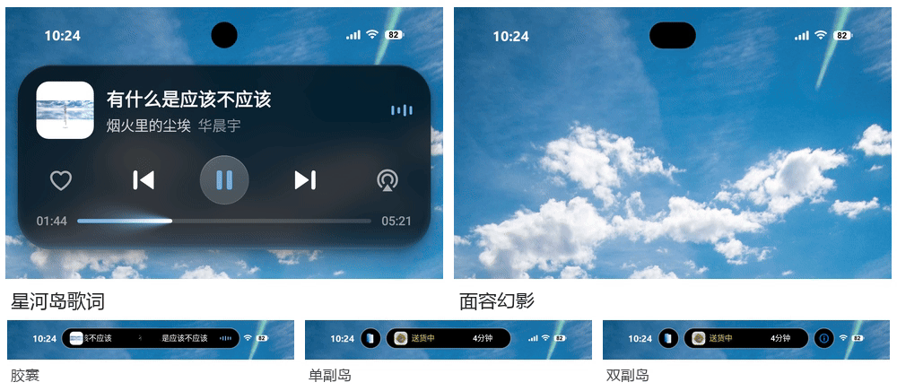
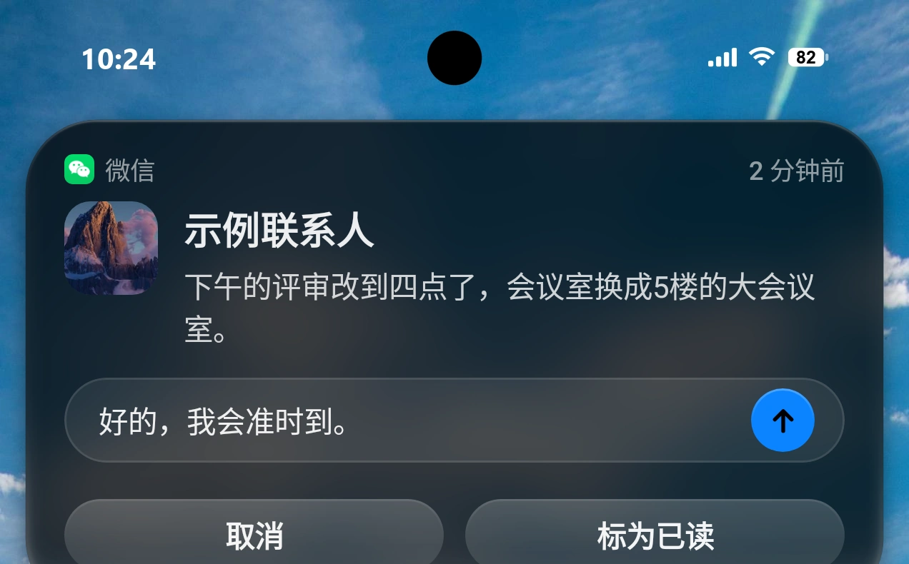

# 星流 AstraFlow

**星河岛在屏幕顶部显示歌词、微信消息和人脸识别动画。胶囊与展开卡片可以分别使用相册里的图片、GIF 或视频作背景。**

[下载正式版](https://github.com/Xposed-Modules-Repo/com.astraflow.tool/releases/latest) · [版本更新日志](https://github.com/Xposed-Modules-Repo/com.astraflow.tool/releases) · [星河岛演示](https://astraflow.cc/island/)

## 星河岛能做什么

- **星河岛歌词。** 在胶囊中查看滚动歌词，也可同时显示原文与译文。展开后可切歌、暂停或调整播放进度。支持词幕、SuperLyric 和系统歌词（LyricInfo）；音乐卡片可调整按钮位置与封面配色。
- **人脸识别岛。** 锁屏解锁时显示识别动画。「面容幻影」在识别成功后显示圆环与对勾，再收回胶囊。在星流内可切换主题并试播成功、失败效果。
- **微信消息上岛。** 在「通知上岛」选中微信，收到通知后可展开查看头像和正文。通知支持快捷回复时，可直接在卡片里输入和发送。
- **图片与视频背景。** 在「外观」中分别为胶囊和展开卡片选择素材、裁选显示区域和调整背景深浅。描边、圆角、位置和动画也可单独设置。
- **胶囊、单副岛与双副岛。** 多项内容同时进行时，主岛显示当前事项，其他事项可显示在一侧或两侧。点按副岛可切换至主岛。

  
  

## 安装与适用范围

星流需要 **Android 15 或以上、Root 权限及 LSPosed**。从 v2.2 起，星河岛面向符合条件的安卓设备，不限品牌。

1. 从[正式发布页](https://github.com/Xposed-Modules-Repo/com.astraflow.tool/releases/latest)下载安装包，在 LSPosed 中启用星流，并按应用提示勾选作用域。
2. OPPO、一加、真我设备须安装并启用与当前版本配套的「流体云事件接入」插件。ColorOS 提供的外卖、打车、导航及计时等系统事件由该插件接入；其他系统的厂商事件按各自的接入情况显示。
3. 重新加载模块或重启手机，打开星流，在「星河岛」中设置功能与外观。

| 星流版本 | 框架要求 | ColorOS 配套插件 |
| --- | --- | --- |
| v2.1 | 支持 API 101 的 LSPosed | 「流体云事件接入」通用版 |
| v2.2 | 支持 API 102 的 LSPosed | ColorOS 15、16、17 分别使用 C15、C16、C17 |

## 更多功能与帮助

星流还提供堆叠通知、浮窗回复、状态栏定制、超高帧录屏、配置备份和插件商店。部分系统功能取决于设备能力。

- **问题反馈：** 登录星流后，打开首页「问题反馈与远程调试」；也可查看[公开处理进度](https://astraflow.cc/feedback)。
- **社区：** QQ 群 **979221822** · [酷安：穆远星](https://www.coolapk.com/u/28719807)。
- **应用接入：** [星河岛开发者平台](https://astraflow.cc/island/develop-quickstart.html)。

Copyright © 2026 穆远星（MuYuanXing）。保留所有权利。
