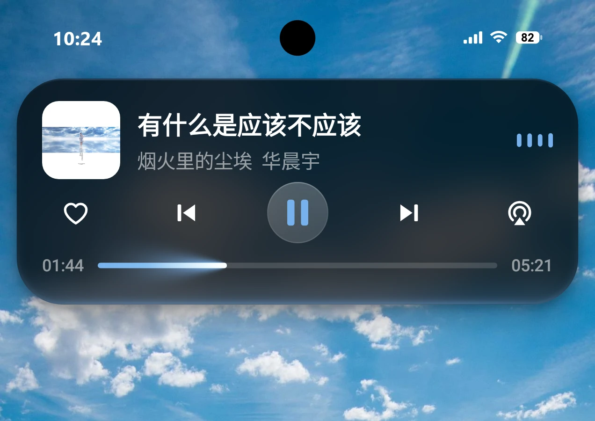
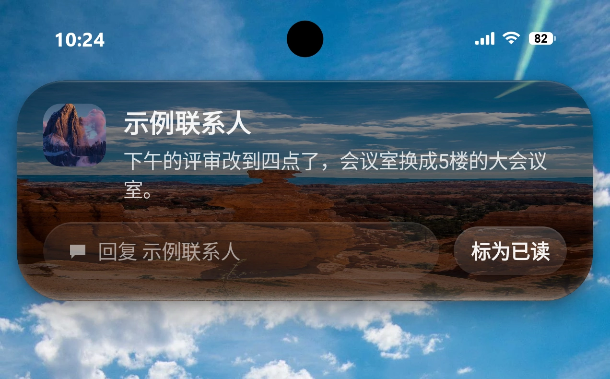

# 星流 AstraFlow

星流主要适配 OPPO、一加和真我。在屏幕顶部的胶囊上看歌词，自选应用通知上岛，也可以常驻显示时间、设备状态和充电信息。胶囊、主副岛与展开卡片均可调整，支持自选背景、位置、大小、动画和显示规则。

[下载星流](https://github.com/Xposed-Modules-Repo/com.astraflow.tool/releases/latest) · [版本更新日志](https://github.com/Xposed-Modules-Repo/com.astraflow.tool/releases) · [星河岛演示](https://astraflow.cc/island/)

  

**当前正式版 v2.2.9**

## 星河岛

- **星河岛歌词。** 让当前歌词直接显示在胶囊上，可选无感滚动或随歌词变化的灵动宽度。展开卡片可查看歌词、切歌、暂停和调整进度。支持 SuperLyric 和系统歌词（LyricInfo）。
- **自选应用上岛。** 从应用列表选择要上岛的应用，在胶囊和展开卡片中查看通知。可按应用设置首条通知自动展开，也可在卡片中回复支持快捷回复的消息。
- **人脸识别岛。** 锁屏进行人脸识别时，星河岛从胶囊展开，播放所选主题和识别结果。应用内可试播「Face ID」「刻环」等主题的成功与失败效果。
- **常驻星河岛与常驻充电岛。** 自定义常驻胶囊的标题和卡片内容，可显示时间、电量、网速等信息。充电时可常驻显示电量和功率。也可以通过常驻星河天气岛查看天气。
- **岛的外观与布局。** 为胶囊和卡片分别设置图片、GIF 或视频背景，调整尺寸、圆角、位置、描边与展开动画。多项活动同时进行时可用主岛和副岛分别显示。
- **内置系统流体云。** ColorOS 15、16、17 的外卖、打车、导航、来电与计时等实时活动可直接显示在星河岛，并在卡片上使用系统提供的操作。

  
  

## 系统增强

- **堆叠通知。** 将同一应用的多条通知在系统通知中心堆叠显示，支持调整堆叠样式和优先应用。
- **状态栏与浮窗回复。** 可调整状态栏图标顺序，设置星河岛的图标避让，并为选定应用开启浮窗回复。
- **手势侧边栏与录屏。** 从屏幕侧边打开常用应用，使用超高帧录屏记录操作。可在星流中备份配置、分享方案或导入社区配置。

标有星尘徽章的功能需要在本设备开通。

## 安装与更新

星流需要 **Android 15 或以上、Root 权限与支持 API 102 的 LSPosed**。系统流体云适用于 ColorOS 15、16、17，随星流安装包交付。各项系统增强功能的可用范围取决于设备和系统版本。

1. 下载安装包，在 LSPosed 中启用星流，并按应用提示勾选所需作用域。
2. 使用系统流体云时，确认已勾选「系统界面」。与系统桌面联动的应用开合动画需要「系统桌面」作用域。
3. 更新时直接覆盖安装，然后在首页右上角「维护」中选择「重启作用域」。

## 反馈与社区

- 登录后，在首页进入「售后工单与远程调试」提交工单。 [公开反馈](https://astraflow.cc/feedback)
- QQ 群 **979221822**。 [酷安 · 穆远星](https://www.coolapk.com/u/28719807)
- 为应用接入星河岛。 [星河岛开发者平台](https://astraflow.cc/island/develop-quickstart.html)

Copyright © 2026 穆远星（MuYuanXing）。保留所有权利。
